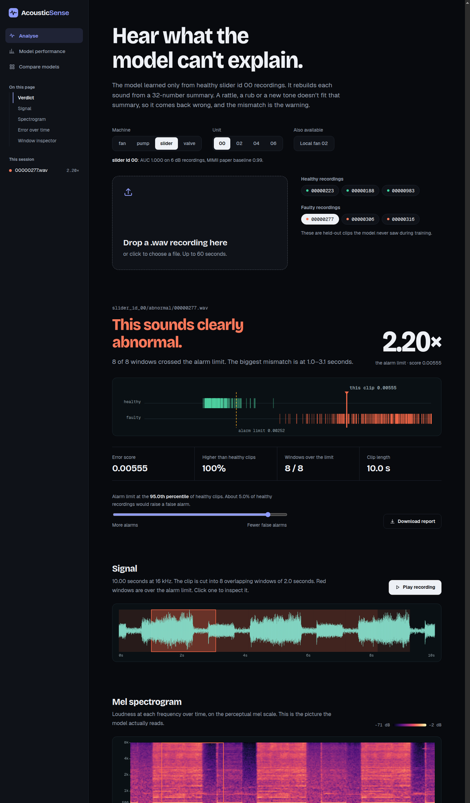
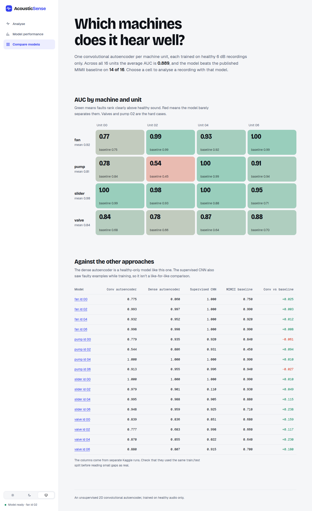
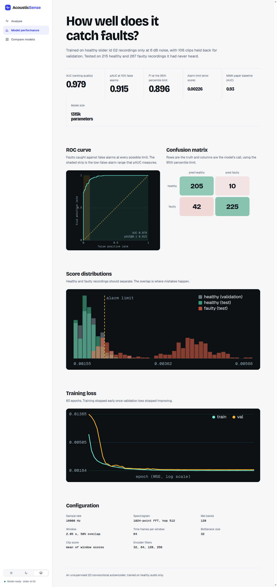

# AcousticSense

> Hear what the model can't explain. AcousticSense finds faults in industrial machines from sound alone, and it learns from **healthy** recordings only.


**Quick links:** [Report (PDF)](report/AcousticSense_Report.pdf) · [Slides](presentation/AcousticSense_Anomaly_Detection.pptx) · [MIMII dataset on Kaggle](https://www.kaggle.com/datasets/bisheshgiri/mimii-dataset) · [AST embeddings notebook](https://www.kaggle.com/code/aadityapyarla/acousticsense-ptembeddast-mahalnobis-v1) · [Supervised CNN notebook](https://www.kaggle.com/code/aadityapyarla/acousticsense-supervisedcnn-aug-v1)

AcousticSense learns what a healthy machine sounds like, then flags any recording it cannot explain. It never sees a faulty example during training, which matters because faults are rare and rarely labelled.

The project has four parts: **Kaggle notebooks** that train and compare four models on the [MIMII dataset](https://zenodo.org/records/3384388), a **FastAPI backend** that serves 16 trained convolutional autoencoders, a **React frontend** that shows what the model heard and why it raised an alarm, and a **two-page paper and a slide deck** that report the comparison.



## Contents

- [What the app does](#what-the-app-does)
- [How it works](#how-it-works)
- [Results](#results)
- [Model comparison](#model-comparison)
- [Notebooks and data](#notebooks-and-data)
- [Repository layout](#repository-layout)
- [Run it locally](#run-it-locally)
- [API](#api)
- [Limits to keep in mind](#limits-to-keep-in-mind)
- [Report and slides](#report-and-slides)
- [Team](#team)
- [Data and licence](#data-and-licence)

## What the app does

- **Analyse a recording.** Upload a `.wav` or pick a held-out sample clip, then choose the machine and unit it came from. You get a plain-language verdict, the error score as a multiple of the alarm limit, and a ruler that places the clip among healthy and faulty reference recordings.
- **See every step.** The page shows the waveform with its analysis windows, the Mel spectrogram, the error over time, and a window inspector with the model's input, its reconstruction and the difference map. It also shows the error per frequency band and the 32-number latent summary. You can play the audio and watch the playhead move.
- **Tune the alarm.** A slider moves the threshold along the healthy-score percentiles, and shows the false-alarm rate that implies.
- **Check the model.** The performance tab shows AUC, pAUC, F1, the ROC curve, the confusion matrix, score distributions and loss curves for the selected model.
- **Compare models.** The compare tab shows AUC for all 16 units against the dense autoencoder, the supervised CNN and the published MIMII baseline.
- **Light and dark themes** with a switch in the sidebar, and a downloadable JSON report for each analysis.

| Compare models | Model performance |
|---|---|
|  |  |

## How it works

1. **Preprocess.** Each clip is cut into 2.05 s windows with 50% overlap. Each window becomes a 128 x 64 log-Mel spectrogram (16 kHz, 1024-point FFT, hop 512). Values are min-max scaled with the range of the **healthy training set only**.
2. **Reconstruct.** A 2D convolutional autoencoder squeezes each window through a 32-number bottleneck and rebuilds it. There are no skip connections, so an unfamiliar sound cannot slip past the bottleneck.
3. **Score.** The window score is the mean squared error between input and reconstruction. The clip score is the mean of its window scores.
4. **Decide.** The alarm limit is the 95th percentile of healthy validation clip scores, so about 5% of healthy recordings raise a false alarm.

The architecture follows `CLAUDE.md`: four stride-2 convolution blocks (32, 64, 128, 256 filters), a 32-unit dense bottleneck, four transposed-convolution blocks and a sigmoid output. It has 1.3 M parameters.

## Results

One autoencoder per machine unit, trained on healthy 6 dB recordings on Kaggle. Each cell shows **AUC** with the published MIMII baseline in brackets.

| Machine | id 00 | id 02 | id 04 | id 06 |
|---|---|---|---|---|
| fan | **0.775** (0.75) | **0.993** (0.99) | **0.932** (0.92) | **0.998** (0.99) |
| pump | **0.779** (0.84) | **0.544** (0.45) | **1.000** (0.99) | **0.913** (0.94) |
| slider | **1.000** (0.99) | **0.979** (0.93) | **0.995** (0.88) | **0.948** (0.71) |
| valve | **0.839** (0.68) | **0.777** (0.66) | **0.870** (0.64) | **0.880** (0.70) |

The average AUC across the 16 units is **0.889**, against 0.816 for the published baseline, and the model beats the baseline on **14 of 16** units. Sliders and most fans separate well. Pump id 02 is the hard case, and the valves and fan id 00 sit in the middle, where some faulty clips fall just under the alarm limit.

## Model comparison

Four models were trained and scored on the same 16 units (4 machines x IDs 00, 02, 04, 06, 6 dB), with the same preprocessing and the same alarm limit.

| Model | Notebook | Split | Runs | Mean AUC | pAUC | Bal. acc. | Recall | False alarm |
|---|---|---|---|---|---|---|---|---|
| Dense autoencoder (2.71 M) | `kaggle_1` | blocked (strict) | 16 | **0.913** | 0.791 | 0.769 | 0.644 | 10.6% |
| Convolutional autoencoder, CAE (1.32 M), served by the app | `kaggle_2` | random | 16 | **0.889** | 0.776 | 0.781 | 0.621 | 5.9% |
| AST embeddings + Mahalanobis (86.2 M, frozen) | `kaggle_3` | random, quick run (IDs 00 and 02, up to 150 clips per class) | 8 | **0.875** | 0.742 | 0.760 | 0.629 | 10.8% |
| Supervised CNN (23.8 K, **uses faulty labels**) | `kaggle_4` | blocked* | 16 | **0.829** | 0.811 | 0.833 | 0.762 | 9.5% |

The published MIMII dense autoencoder averages 0.816 AUC.

**Read this table with care.**

- **It is not a like-for-like comparison.** Only the dense model used the strict blocked split. A random split can leak recording sessions and flatter the score. *The supervised split is the notebook default; the exported results do not record it.*
- **On the same 8 runs (IDs 00 and 02)** the mean AUC is 0.887 (dense), 0.875 (AST) and 0.836 (CAE), against 0.786 for the published baseline. No model is declared the winner.
- **The CAE ran to its 60-epoch cap in all 16 runs**, so early stopping never fired and it may be undertrained.
- **Valve is the weakest machine for every model** (recall 0.20 dense, 0.33 CAE, 0.20 AST).
- **The supervised CNN is a different experiment.** It sees faulty clips in training, so it is outside the healthy-only setting. Some of its runs fall far below chance under a blocked split.
- **Latency was never measured.**

A fair comparison needs the CAE and AST notebooks re-run with `SPLIT_MODE = "blocked"` on all units.

## Notebooks and data

| Notebook | What it does | Where |
|---|---|---|
| `kaggle_1_dense_autoencoder.ipynb` | Dense frame-stack autoencoder (MIMII-baseline style) | this repo |
| `kaggle_2_conv_autoencoder_CAE.ipynb` | The 2D convolutional autoencoder served by the app | this repo |
| `kaggle_3_ast_embeddings.ipynb` | Frozen AST embeddings with Mahalanobis scoring | this repo, and [on Kaggle](https://www.kaggle.com/code/aadityapyarla/acousticsense-ptembeddast-mahalnobis-v1) |
| `kaggle_4_supervised_cnn.ipynb` | Supervised CNN with augmentation (uses faulty labels) | this repo, and [on Kaggle](https://www.kaggle.com/code/aadityapyarla/acousticsense-supervisedcnn-aug-v1) |
| `local_dense_and_conv_autoencoder.ipynb` | The original local notebook | this repo |

**Run one on Kaggle**

1. Add the [MIMII dataset](https://www.kaggle.com/datasets/bisheshgiri/mimii-dataset) as an input.
2. Turn on a GPU (**Settings > Accelerator**). The AST notebook also needs **Internet** on, once, to download the pretrained model.
3. Set `QUICK = True` for a short check (2 IDs, 150 clips per class), then `QUICK = False` for the full run.
4. Choose `SPLIT_MODE`: `"random"`, or `"blocked"` (clips cut in file-name order, a stricter test).
5. Each notebook writes its CSVs, figures and a zip to `/kaggle/working`. Unzip the result into `export_<name>/` to use it here.

The data comes from the MIMII dataset. We use IDs 00, 02, 04 and 06, the 6 dB condition and microphone 1 of 8 (18,019 clips).

## Repository layout

```
backend/
  app/            FastAPI service: audio features, detector, model registry, routes
  scripts/        build_registry.py (CSV exports -> registry), fetch_samples.py (sample clips)
  artifacts/cae/  registry.json and samples.json (model weights are not committed)
  train.py        train and export one local model
  tests/          API tests
frontend/         React + TypeScript + Vite app
kaggle_1_dense_autoencoder.ipynb       dense frame-stack autoencoder (MIMII-baseline style)
kaggle_2_conv_autoencoder_CAE.ipynb    the 2D convolutional autoencoder served by the app
kaggle_3_ast_embeddings.ipynb          AST embeddings with Mahalanobis scoring
kaggle_4_supervised_cnn.ipynb          supervised CNN (uses faulty labels, so not like-for-like)
local_dense_and_conv_autoencoder.ipynb the original local notebook
export_cae/ export_dense/ export_sup/  results exported from the Kaggle runs
presentation/     generates the 13-slide deck (see presentation/README.md)
report/           the two-page paper: source, figures script and PDF (see report/README.md)
docs/screenshots/ images used in this README
```

## Run it locally

You need Python 3.12 or newer, Node 20 or newer, and a TensorFlow-capable machine. A GPU is optional, since inference is light.

```bash
# 1. Python environment
python -m venv .venv && source .venv/bin/activate
pip install -r backend/requirements.txt

# 2. Models: unzip the 16 trained models and build the registry from the CSV exports.
#    (The zip is named dense_models.zip but contains the convolutional autoencoders.)
unzip dense_models.zip -d backend/artifacts/cae
python backend/scripts/build_registry.py --exports .

# 3. Optional: sample clips for every machine unit (3 healthy + 3 faulty each, about 235 MB).
#    Pulls only the chosen files from the 6 dB MIMII zips on Zenodo with HTTP range requests.
python -I backend/scripts/fetch_samples.py --out data/samples --per-class 3
python backend/scripts/build_registry.py --exports .      # re-run to register the clips

# 4. Backend  (API docs at http://127.0.0.1:8000/docs)
cd backend && uvicorn app.main:app --port 8000

# 5. Frontend  (http://localhost:5173, proxies /api to the backend)
cd frontend && npm install && npm run dev
```

Run the backend tests with `PYTHONPATH=backend pytest backend/tests`. To train the extra local fan id_02 model, run `PYTHONPATH=backend python backend/train.py --data fan/id_02`.

Settings: `API_URL` points the dev proxy at a different backend, `VITE_API_URL` sets the API base URL for a production build, and `CORS_ORIGINS` lists the origins the backend allows.

## API

| Route | Purpose |
|---|---|
| `GET /api/models` | All models with headline metrics and the default model |
| `GET /api/models/{id}` | ROC, score distributions, confusion matrix, loss curves and config for one model |
| `POST /api/analyze?model=ID` | Upload a `.wav` and get the score, verdict, waveform, Log-Mel and per-window input, reconstruction and error maps |
| `GET /api/samples?model=ID` | Held-out sample clips for the model's machine and unit |
| `POST /api/analyze/sample/{id}?model=ID` | Analyse a sample clip |
| `GET /api/samples/{id}/audio` | Stream a sample clip |
| `GET /api/health` | Liveness and model count |

## Limits to keep in mind

- **Noise level matters.** The 16 models were trained on 6 dB recordings. Audio recorded at a different noise level, such as the -6 dB clips in a local `fan/` folder, can score high even when healthy.
- **One model per unit.** A model only knows its own machine unit. Pick the matching machine and unit before analysing.
- **Comparison columns come from separate Kaggle runs.** Check that they used the same split before reading small gaps as real (see [Model comparison](#model-comparison)). The supervised CNN also saw faulty examples while training, and some of its runs collapsed under a blocked split.
- **Weights are not in the repo.** Each model is 16 MB, so they are gitignored and rebuilt from the zip as shown above.

## Report and slides

- **Paper:** [`report/AcousticSense_Report.pdf`](report/AcousticSense_Report.pdf), a two-page, two-column write-up of the method, the comparison and its limits.
- **Slides:** [`presentation/AcousticSense_Anomaly_Detection.pptx`](presentation/AcousticSense_Anomaly_Detection.pptx), 13 slides comparing the dense autoencoder, the CAE and AST embeddings.

Both are generated from the exported results, so they can be rebuilt. See `report/README.md` and `presentation/README.md`.

## Team

Aaditya Pyarla, Raja Kumar, Nirmal Kattady and Deepak Choudhary, Indian Institute of Information Technology, Design and Manufacturing, Jabalpur.

## Data and licence

The audio comes from the [MIMII dataset](https://zenodo.org/records/3384388), released under CC BY-SA 4.0 (also available as a [Kaggle copy](https://www.kaggle.com/datasets/bisheshgiri/mimii-dataset)). Please cite Purohit et al., "MIMII Dataset: Sound Dataset for Malfunctioning Industrial Machine Investigation and Inspection" (DCASE 2019 Workshop). Downloaded audio stays in `data/` and is not committed.
